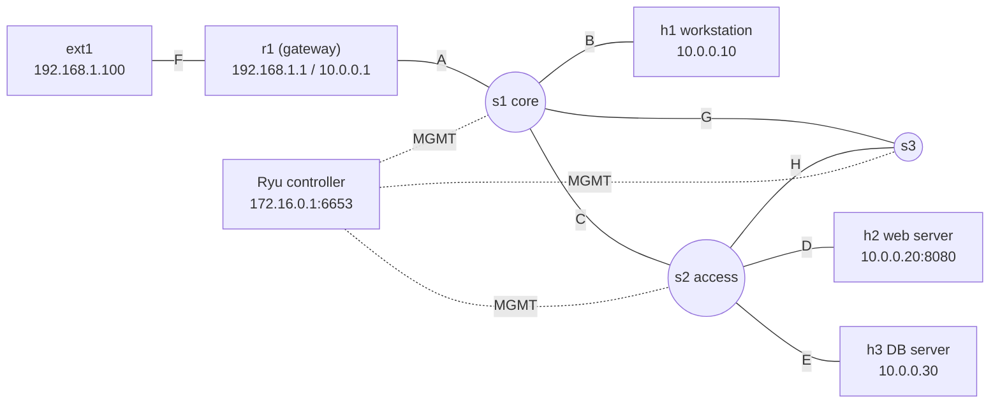

# SDN Ring Topology with Firewall and Policy Routing (Kathará + Ryu)

A Software-Defined Networking lab built with [Kathará](https://www.kathara.org/),
Open vSwitch and a [Ryu](https://ryu-sdn.org/) OpenFlow 1.3 controller.
Starting from a linear two-switch campus network, the project:

1. closes a **physical ring** by adding a third switch (`s3`);
2. enforces a **stateless L3 firewall** in the data plane (`h1` ↔ `h3` blocked);
3. implements **asymmetric policy routing** over the ring (`h1 → h2` is detoured
   through `s3`, the return path stays direct);
4. keeps the loop harmless with **controlled ARP flooding** and **Proxy ARP**,
   since a Layer-2 loop would otherwise cause a broadcast storm.

Author: Diego Banfi — University of L'Aquila, DISIM (Dept. of Information
Engineering, Computer Science and Mathematics), A.Y. 2025–2026.
Supervisor: Prof. Carlo Centofanti.

> The full write-up (design, code walkthrough, experimental validation) is in
> [`docs/report/sdn_ring_report.pdf`](docs/report/sdn_ring_report.pdf).

## Topology



Solid lines are data-plane links, dotted lines the out-of-band management
network. `G` and `H` are the two collision domains added to close the ring
`s1 – s2 – s3 – s1`.

OpenFlow port numbers (assigned by Open vSwitch in the order the interfaces are
added to each bridge — they are **not** the same as the `ethN` numbers):

| Switch | Port 1 | Port 2 | Port 3 | Port 4 |
|--------|--------|--------|--------|--------|
| `s1`   | r1     | h1     | s2     | s3     |
| `s2`   | s1     | h2     | h3     | s3     |
| `s3`   | s1     | s2     | –      | –      |

## Implemented policies

| Priority | Policy | Behaviour |
|---------:|--------|-----------|
| 300 | Firewall | All IPv4 traffic between `h1` (10.0.0.10) and `h3` (10.0.0.30) is dropped in both directions. The rule is installed reactively on the first offending packet; later packets are dropped by the switch itself. |
| 200 | Policy routing | `h1 → h2` follows `h1 → s1 → s3 → s2 → h2`; `h2 → h1` follows `h2 → s2 → s1 → h1`. Flows are pushed proactively when each switch connects. |
| 1 | MAC learning | Generic L2 learning switch for everything not covered above. |
| 0 | Table-miss | Unmatched packets go to the controller. |

Higher priority wins, so a security rule always overrides routing, and routing
always overrides plain L2 forwarding.

**Loop avoidance.** ARP requests entering from a host port are flooded once;
requests relayed by another switch are delivered only to local host-facing
ports. If the controller already knows the target MAC it answers itself
(Proxy ARP), so no broadcast travels around the ring.

## Repository layout

```text
.
├── README.md
├── docker/
│   └── Dockerfile.sdn            # image for the Ryu controller node (asdn/sdn)
├── lab/                          # the Kathará lab (run kathara commands here)
│   ├── lab.conf                  # topology: nodes, interfaces, collision domains
│   ├── controller.startup        # starts Ryu on TCP 6653
│   ├── controller/
│   │   └── ryu_campus.py         # OpenFlow 1.3 controller application
│   ├── s1.startup  s2.startup  s3.startup   # Open vSwitch bridges
│   ├── r1.startup                # gateway router
│   └── h1.startup  h2.startup  h3.startup  ext1.startup
└── docs/
    ├── report/
    │   ├── sdn_ring_report.pdf   # final report (English)
    │   ├── report.tex            # LaTeX source
    │   ├── figures/              # logos
    │   └── screenshots/          # captured test output used in the report
    └── report_it_original.pdf    # original Italian report (kept for reference)
```

## Prerequisites

- [Docker](https://docs.docker.com/get-docker/)
- [Kathará](https://github.com/KatharaFramework/Kathara) (provides `kathara`
  and the `kathara/sdn` image used by the switches)
- Git

## Quick start

```bash
git clone https://github.com/Diegobanfi/progetto-sdn-kathara.git
cd progetto-sdn-kathara

# 1. Build the controller image (once)
docker build -t asdn/sdn -f docker/Dockerfile.sdn docker/

# 2. Start the lab
cd lab
kathara lstart

# 3. Stop and remove everything when done
kathara lclean
```

`kathara lstart` starts the controller, `s1`–`s3`, `r1` and the hosts. Open a
shell on any node with `kathara connect <node>` (e.g. `h1`, `s1`, `controller`).

## Verifying the behaviour

Run the commands in the indicated node. Details and captured output are in the
report (Section 5).

```bash
# h1 -> h2 allowed (via s1 -> s3 -> s2)
h1$ ping -c 4 10.0.0.20

# Firewall: h1 <-> h3 blocked in both directions
h1$ ping -c 4 -W 1 10.0.0.30
h3$ ping -c 4 -W 1 10.0.0.10

# h2 stays reachable from both
h2$ ping -c 4 10.0.0.10 && ping -c 4 10.0.0.30

# Flow tables: priority 200 = routing, priority 300 = firewall drop
s1$ ovs-ofctl -O OpenFlow13 dump-flows s1     # same for s2, s3

# External client reaches the web server through r1
ext1$ curl http://10.0.0.20:8080
ext1$ iperf3 -c 10.0.0.20        # start `iperf3 -s` on h2 first

# Proxy ARP / controlled flooding: watch the controller log
controller$ # ryu-manager output: "ARP from ...", "ARP PROXY REPLY ..."
```

Expected results: `h1 ↔ h2` and `h2 ↔ h3` succeed, `h1 ↔ h3` shows 100 % packet
loss, `s3` has **no** flow for `10.0.0.20 → 10.0.0.10` (the return path does not
cross it), and the ring causes no broadcast storm.

## Known limitations

- Port numbers in `STATIC_ROUTES` and `SWITCH_PORTS` are hard-coded for this
  topology; adding nodes means updating them.
- The firewall drop flows have no timeout and only the switch that first sees
  the traffic gets the rule.
- An ARP reply whose destination MAC is unknown falls back to `OFPP_FLOOD`,
  which is not loop-filtered (it only happens if the requester was never
  learned).
- IPv6 is ignored.

## License

No license has been set yet; all rights reserved by the author unless stated
otherwise.
